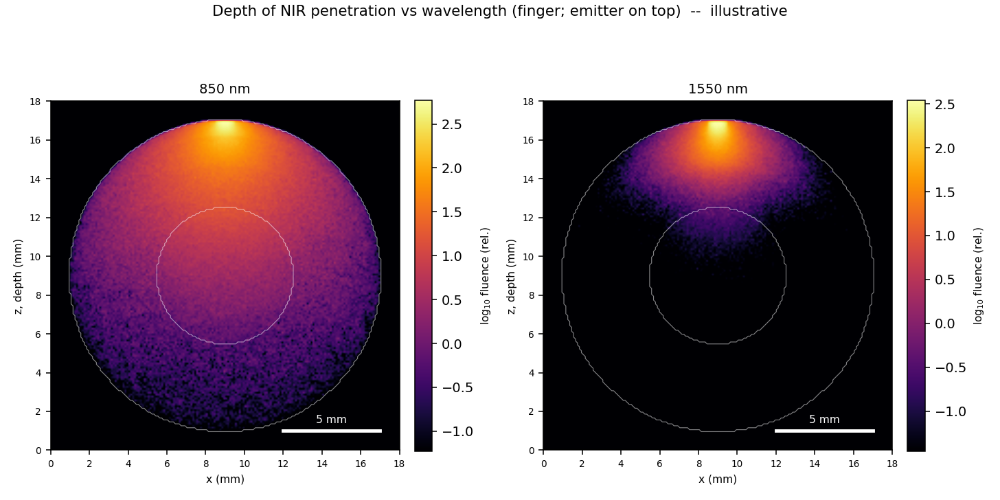

# Tissue Optics Explorer

An interactive look at how near-infrared and shortwave-infrared light travels through skin. A small CPU Monte Carlo simulates photon transport in an anatomically layered finger and wrist, using optical properties built from published chromophore spectra, and the results are packed into a single web page you can rotate, slice and drive with sliders.

**Live demo:** https://gabe729.github.io/tissue-optics-explorer/



## What you can do with it

- Watch light spread through tissue as a 3D fluence cloud inside a translucent finger or wrist, with a live cross-section showing how much of the absorbed light each layer takes.
- Move sliders for wavelength (500–2500 nm), skin tone (epidermal melanin), tissue scattering and dermis thickness.
- Switch to a source–detector view: the sensitivity "banana" for a chosen source–detector distance, and the detected reflectance against distance and wavelength, with sliders for blood oxygen saturation and blood volume.
- Run the Monte Carlo yourself at any wavelength, make labelled matplotlib cross-sections, or render the tissue and light in Blender.

## Quick start

```bash
pip install -r requirements.txt

python optics_nir.py                  # print optical properties and sanity checks
python mc_finger.py 850 1e6           # Monte Carlo at 850 nm -> outputs/finger_850nm.{npy,json}
python mc_finger.py 1550 1e6
python render_section.py finger_850nm         # labelled cross-section PNG
python render_section.py compare 850 1550     # depth comparison PNG (the image above)
```

A million photons takes roughly 10–20 seconds on a recent laptop CPU. Outputs go to `outputs/`, which is not tracked.

To view the prebuilt explorer locally, open `docs/index.html` in a browser. It was built with `python run_2500_sweep.py 200000 14` (200,000 photons per fluence grid point, 10^6 per detector wavelength; about an hour on 14 cores). It loads Plotly from a CDN, so it needs an internet connection.

## Pipeline

```
data/*.csv ──> optics_nir.py ──> tov_common.py ──> mc_core.py / mc_white.py ──┬─> explorer_build.py ──> explorer HTML
 (spectra)    (μa, μs, g, n     (geometry, layers,  (CPU Monte Carlo)          ├─> render_section.py ──> PNG figures
               per tissue)       tissue labels)                                 └─> blender_tissue.py ──> Cycles render
```

| File | Role |
| --- | --- |
| `optics_nir.py` | Optical properties. Mixes oxy- and deoxyhaemoglobin, water, lipid and melanosome absorption by tissue composition, with power-law reduced scattering, to give μa, μs, g and n for each tissue at any wavelength from 500 to 2500 nm. |
| `tov_common.py` | Geometry. A layered cylinder (epidermis, superficial vascular plexus, dermis, fat, muscle, bone) for two sites: a finger with a central bone core, and a large-radius wrist with bone as the deepest layer. Also field input/output. |
| `mc_core.py` | Voxel Monte Carlo in NumPy: Henyey–Greenstein scattering, absorption weighting with Russian roulette, and a track-length fluence estimator. |
| `mc_finger.py` | Command-line wrapper: one wavelength, one fluence field. |
| `mc_white.py` | Absorption-free ("white") Monte Carlo that records each remitted photon's exit distance and path length per tissue, so reflectance for any absorption setting follows by Beer–Lambert reweighting. |
| `explorer_build.py` | Runs the parameter sweeps, compresses the fluence fields (SVD with an 8-bit basis), builds the detector tensor, and injects everything into `explorer_template.html`. |
| `run_2500_sweep.py` | Rebuilds both sites over the full grid and merges them into one page. |
| `render_section.py` | Labelled matplotlib cross-section and a side-by-side wavelength comparison. |
| `blender_tissue.py` | Blender Cycles render of the tissue (translucent skin, bone, layer cross-section) with the fluence as a glowing voxel cloud. |
| `data/` | The two spectral tables, their sources and licences, and a script to re-download the water table. |

### Rebuilding the explorer

```bash
python explorer_build.py test 100000 finger      # tiny grid; writes outputs/tissue_optics_explorer.html
python run_2500_sweep.py 200000 12               # full finger + wrist sweep on 12 worker processes
cp outputs/tissue_optics_explorer.html docs/index.html
```

The last argument is the number of worker processes; each needs about 0.5 GB of memory, and results are identical whatever the count. The full grid is about 8,500 fluence simulations plus 270 detector wavelengths: at 200,000 photons per grid point, roughly 8 hours on one core or about an hour on 14 cores of a recent laptop; time scales with the photon count. The sweep caches every grid point under `outputs/`, so an interrupted run resumes where it stopped. The full page is about 17 MB.

### Blender render

```bash
python mc_finger.py 850 1e6
blender --background --python blender_tissue.py -- finger_850nm 96 0
# arguments: field name, Cycles samples, view (0 oblique, 1 down the axis, 2 top, 3 other oblique, 4 all)
```

Written for Blender 4.x. It uses the GPU where Cycles finds one and falls back to the CPU otherwise. Run it from the repository folder so it finds `outputs/`.

## Model and its limits

This is a tool for intuition, not dosimetry. The numbers are of the right order; they are not validated against measurements of any particular person or tissue.

- **Optical properties are literature-order.** Composition fractions and scattering power laws follow Jacques (2013); chromophore spectra come from the Roblyer et al. (2025) stitched dataset. Whole-blood absorption agrees with Bosschaart et al. (2014) at common near-infrared wavelengths, and skin values fall within the ranges reported by Troy and Thennadil (2001) and Bashkatov et al. (2005). Real people vary a lot.
- **Beyond 2000 nm,** water comes from Segelstein (1981), but lipid and haemoglobin are held at their 2000 nm values because the bundled tables stop there. Water dominates absorption in that band, so the effect is small, but the extension is not measured structure.
- **The geometry is simplified.** Tissues are concentric layers of a cylinder with fixed thicknesses (dermis adjustable). Blood is spread through the layers as a volume fraction rather than as discrete vessels.
- **The transport is simplified.** Light enters with a specular loss at the surface but leaves without Fresnel reflection or total internal reflection, so fluence just under the skin is somewhat underestimated. Steps are not split at internal layer boundaries. The domain is truncated along the finger's axis.
- **The fluence scale is illustrative.** Fields are shown on a log scale, normalised so the brightest point maps to 1 mW/mm², over five decades.
- **The blood-volume slider** changes absorption only; it holds blood's small scattering contribution fixed.

## Credits

- S. L. Jacques, "Optical properties of biological tissues: a review," *Phys. Med. Biol.* 58, R37–R61 (2013). Tissue composition, scattering power laws and the melanosome absorption law.
- D. Roblyer et al., "Review of shortwave infrared imaging and spectroscopy in tissue [Invited]," *Biomed. Opt. Express* 16(12), 5028–5062 (2025), and its Dataset 1 (CC BY 4.0). Haemoglobin, water and lipid spectra.
- D. J. Segelstein, "The complex refractive index of water," M.S. thesis, University of Missouri–Kansas City (1981), via the Oregon Medical Laser Center tables. Water absorption beyond 2000 nm.
- N. Bosschaart et al., "A literature review and novel theoretical approach on the optical properties of whole blood," *Lasers Med. Sci.* 29, 453–479 (2014). Blood check.
- T. L. Troy and S. N. Thennadil, "Optical properties of human skin in the near infrared wavelength range of 1000 to 2200 nm," *J. Biomed. Opt.* 6(2), 167–176 (2001). Skin check.
- A. N. Bashkatov et al., "Optical properties of human skin, subcutaneous and mucous tissues in the wavelength range from 400 to 2000 nm," *J. Phys. D: Appl. Phys.* 38, 2543–2555 (2005). Skin check.
- L. Wang, S. L. Jacques and L. Zheng, "MCML — Monte Carlo modeling of light transport in multi-layered tissues," *Comput. Methods Programs Biomed.* 47, 131–146 (1995). The photon weighting, roulette and scattering scheme.
- [Plotly.js](https://plotly.com/javascript/) for the interactive page; [Blender](https://www.blender.org/) for the renders.

Data sources and licences are detailed in [`data/README.md`](data/README.md).

## Licence

Code: MIT (see `LICENSE`). The bundled data files keep their own terms (see `data/README.md`).

Provided as is, without support.
